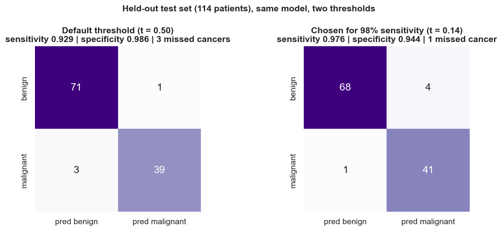
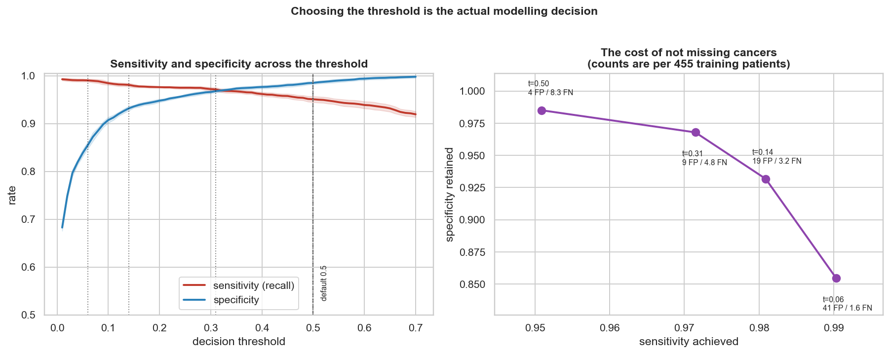
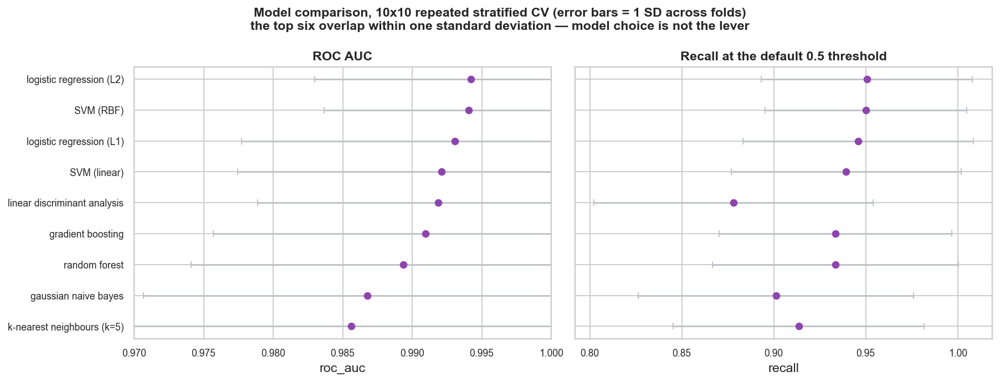
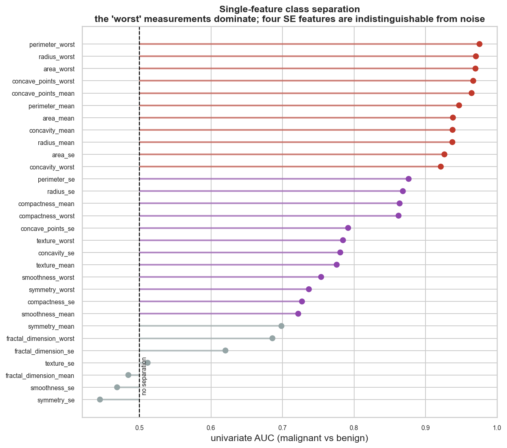
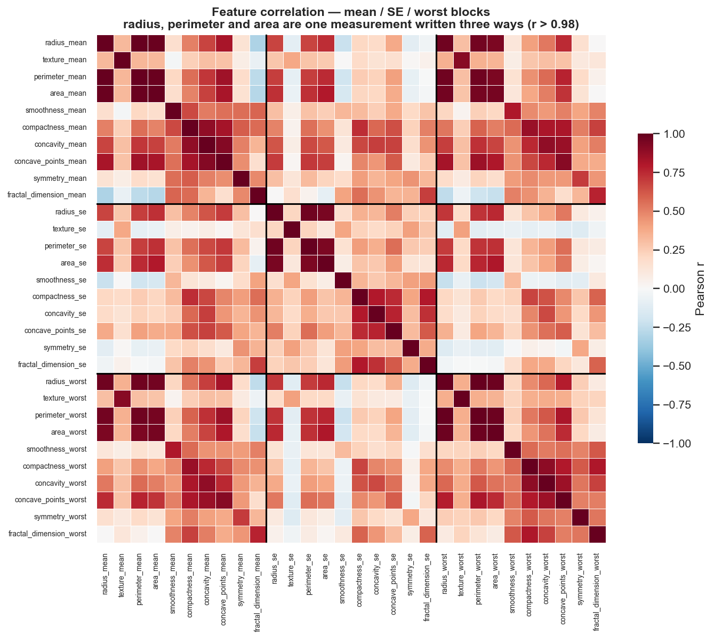

# Breast Cancer Malignancy Classification

**Moving the decision threshold from 0.50 to 0.14 cuts missed cancers from 3 of 42 to 1 of 42,
for 0.9 percentage points of accuracy and three extra biopsies.**

Classifying breast masses as malignant or benign from 30 nuclear morphometry features,
measured on digitised fine-needle aspirate images of 569 patients.

The modelling result is not the interesting part — nearly every classifier reaches ~97%
on this dataset, and the original authors did so in 1993 with three features. This
project is about the decision that comes after: **where to put the threshold, and what
it costs.**

---

## The finding

**The model that reports worse accuracy is the better diagnostic tool.**

Both columns below are the *same fitted model* evaluated on the *same 114 held-out
patients*. The only difference is the decision threshold.

| | Default (0.50) | Chosen (0.14) |
|---|---:|---:|
| Accuracy | **96.5%** | 95.6% |
| Sensitivity | 92.9% | **97.6%** |
| Specificity | 98.6% | 94.4% |
| **Missed cancers** | **3 of 42** | **1 of 42** |
| False alarms | 1 | 4 |

Lowering the threshold costs **0.9 percentage points of accuracy** and prevents **two of
three missed cancers**, at a price of three additional biopsies.



The default 0.5 threshold is not a neutral choice. It encodes the assumption that a
false positive and a false negative cost the same. In breast cancer diagnosis a false
positive means an unnecessary biopsy; a false negative means a cancer sent home. Almost
every published version of this dataset reports accuracy at 0.5 and never names that
assumption.

### What each level of sensitivity costs

Measured on out-of-fold predictions over the 455 training patients, averaged across 20
fold-shufflings so the curve reflects the data rather than one random split.

| Sensitivity target | Threshold | Specificity | Missed cancers | False alarms |
|---|---:|---:|---:|---:|
| 95% *(what the default gives)* | 0.50 | 98.5% | 8.4 | 4.3 |
| 97% | 0.31 | 96.8% | 4.9 | 9.2 |
| **98%** *(chosen)* | **0.14** | **93.2%** | **3.3** | **19.5** |
| 99% | 0.06 | 85.5% | 1.7 | 41.4 |



Going from the default to 99% sensitivity cuts missed cancers by four fifths and costs
13 points of specificity — 4 false positives become 41. The curve is nearly flat from
0.50 down to 0.30 and then falls away: the first two points of sensitivity are cheap,
the last one is not.

**98% was chosen because that is where the curve turns.** That is a judgement, not a
result, which is why the whole curve is published and `TARGET_SENSITIVITY` is a named
constant in [`run_analysis.py`](run_analysis.py) rather than a magic number. The
threshold was selected on training data alone and delivered **97.6% sensitivity on
held-out patients** — it transferred.

---

## Why the modelling is not the story

**Nine classifiers, one answer.** Linear and non-linear boundaries, a local method, an
independence assumption, two tree ensembles. The top six span 0.9921–0.9942 ROC AUC
against a fold-to-fold standard deviation of ~0.011 — the entire spread between them is
a fifth of the noise in any single estimate.



Tuning does not rescue it either: sweeping `C` across four orders of magnitude moves AUC
by **0.00008**, roughly 140× smaller than the fold-to-fold standard deviation. Selecting
that value would be fitting noise and taking credit for it.

This is a property of the problem. `wdbc.names` states the classes are linearly separable
on all 30 features, and the 1993 authors reported 97.5% accuracy from **three** of them.
A modern model reaching 97% has matched a thirty-year-old linear-programming decision
tree.

**Two thirds of the features are redundant.**

| Feature set | n | ROC AUC | Recall | Accuracy |
|---|---:|---:|---:|---:|
| All features | 30 | 0.9942 | 0.9506 | 0.9725 |
| **"Worst" measurements only** | **10** | 0.9913 | **0.9541** | **0.9743** |
| "Mean" measurements only | 10 | 0.9854 | 0.8900 | 0.9378 |
| "SE" measurements only | 10 | 0.9329 | 0.7459 | 0.8624 |
| Authors' 3 features (1993) | 3 | 0.9905 | 0.9182 | 0.9608 |

The 10 "worst" features **match all 30** — nominally ahead on both recall and accuracy,
behind by 0.003 on AUC. A paired test on identical folds favours all 30 at p = 0.034,
but repeated CV folds overlap heavily, so that p-value is anti-conservative; the effect
size is +0.0028 AUC, about a fifth of the fold-to-fold standard deviation, and it does
not show up in recall or accuracy at all.

This is an operational finding, not just a statistical one: **the mean and standard-error
aggregations are not worth computing.** Malignancy shows up in the *worst* nuclei in an
image, not in the average one — which is why averaging over the whole image (the "mean"
block) does measurably worse.

---

## Three decisions that changed the answer

**1. The 13 rows of zeros are real measurements, and imputing them would destroy signal.**

Six columns — concavity and concave points, at all three aggregation levels — contain
exact zeros in 13 rows. Zeros in a continuous column are the classic signature of a
missing-value code, and the reflex is to impute.

The evidence says otherwise. The zeros are **all-or-nothing** (no row is zero on some
concavity columns but not others, which a sporadic missing code would not produce); the
13 rows sit in the **bottom 8th percentile** of every size measurement; **all 13 are
benign**; and `compactness` — computed as `perimeter²/area − 1`, mathematically unrelated
to concavity — is present and non-zero for all of them, so no truncated processing step
explains it.

They are a biological floor: a small, round, benign nucleus has a convex contour with no
concave portions to measure. Imputing a median would push 13 benign patients toward the
malignant region and delete the strongest categorical signal in the data.
[`test_zero_concavity_rows_are_all_or_nothing`](tests/test_data.py) pins it.

**2. Downloaded from UCI rather than imported from scikit-learn.**

`load_breast_cancer()` returns this exact data in one line, and drops the `id` column.
Without patient IDs there is no way to verify that 569 rows are 569 *patients* — and if
any patient appeared twice, cross-validation folds would share them and every number
downstream would be inflated. They are all distinct, but that is a checked fact rather
than an assumption. The UCI archive also ships `wdbc.names`, which is where the 1993
benchmark that frames this whole project comes from.

**3. The threshold was chosen on out-of-fold training predictions, never on the test set.**

The held-out 114 patients are scored exactly once, in the last section of notebook 03.
The split is defined in [`src/data.py`](src/data.py) and imported everywhere, so "used
once" is enforced by the code rather than promised in prose. Scaling sits inside every
CV pipeline, never fitted on the full training matrix — on a dataset this separable that
leak would be small, which is exactly what makes it dangerous.

---

## What the data looks like



Four of the top five single features are `_worst` measurements. Four features —
`texture_se`, `fractal_dimension_mean`, `smoothness_se`, `symmetry_se` — sit at or below
AUC 0.51 and do not survive Benjamini-Hochberg correction across the 30 tests. Three of
those four are SE columns: the *variability* of a measurement across nuclei carries far
less information than its level.



**23 of 30 features have a VIF above 10**; `radius_mean` reaches 3,806. Part of that is
not empirical at all — for an approximately circular nucleus, area = πr² and
perimeter = 2πr *by definition*, and the observed correlations exceed 0.99. Radius,
perimeter and area are one measurement written three ways.

PCA agrees: PC1 alone absorbs 44.6% of the variance in 30 standardised columns, and it
takes 10 components to reach 95%. Thirty columns carry about ten columns of independent
information — which is exactly what the 10 measurements × 3 aggregations construction
predicts, and why dropping two thirds of them costs nothing.

Consequence for the write-up: **coefficients are read as association, never as
mechanism.** With VIFs in the thousands the model trades weight between collinear columns
freely. L2 was preferred over L1 for the headline model for the same reason — L1 would
arbitrarily keep one of each collinear cluster and zero the rest, which is fine for
prediction and actively misleading if anyone reads the survivors as "the features that
matter".

---

## Limitations

**This is not a clinical tool and could not become one.** It classifies pre-extracted
morphometric features, not images; it has no regulatory validation and no prospective
evaluation. The label is a diagnosis a pathologist already made — the model reproduces
expert judgement on curated data, it does not replace it.

**The test set is 114 patients.** One patient is 0.9 percentage points. The 95% Wilson
interval on the headline 97.6% sensitivity is **[0.877, 0.996]** — quoting a point
estimate to four decimals from 42 malignant cases would be false precision.

**Selection bias is unquantifiable here.** These are masses that were already biopsied —
suspicious enough for a clinician to act. The 37% malignancy rate is a property of that
referral filter, not of any population. In a screening setting, where prevalence is far
lower, the same sensitivity and specificity would produce many more false positives per
true one, and the precision figures here would not transfer.

**Some errors are irreducible.** One malignant case (patient 892189) is scored at 0.0018
by every model in every fold — its measurements sit in the bottom 5th percentile of
malignant cases. No threshold rescues it; 100% sensitivity is unreachable at any cut
worth using. Catching that patient needs information a morphometry image does not carry.

**The data is from one institution in the early 1990s.** Imaging equipment, staining
protocols and referral populations have all changed since.

---

## Reproducing

```bash
python -m venv .venv && .venv/Scripts/activate   # Windows; use bin/activate on Unix
pip install -r requirements.txt
python src/acquisition.py     # downloads from UCI, writes a provenance record
python run_analysis.py        # every number and figure in this README
pytest                        # 27 tests
```

Runtime is a few minutes; the repeated cross-validation dominates it.

## Layout

```
src/acquisition.py   Download from UCI, checksum, record provenance
src/data.py          Loading, validation, the one canonical train/test split
src/profiling.py     Data-quality checks, collinearity, univariate separation
src/models.py        Candidate pipelines (scaler always inside the pipeline)
src/evaluation.py    Metrics, threshold sweep, sensitivity targeting, Wilson intervals
src/figures.py       Every figure in this README
run_analysis.py      Runs all of it, writes outputs/results/ and outputs/figures/
notebooks/           01 acquisition & quality -> 02 EDA -> 03 modelling
tests/               27 tests pinning the claims above
```

The notebooks carry the argument and are meant to be read in order. `run_analysis.py`
reproduces every artifact without them.

## Data

Wolberg, W., Mangasarian, O., Street, N., & Street, W. (1993). *Breast Cancer Wisconsin
(Diagnostic)* [Dataset]. UCI Machine Learning Repository.
<https://doi.org/10.24432/C5DW2B>

Licence: **CC BY 4.0**. Redistribution is permitted with attribution; the data is
nonetheless not committed here. `src/acquisition.py` downloads it and records the
SHA-256 of the exact bytes used, so provenance and file stay guaranteed consistent.

Code in this repository is MIT licensed — see [LICENSE](LICENSE). The licence covers the
code, not the data.
